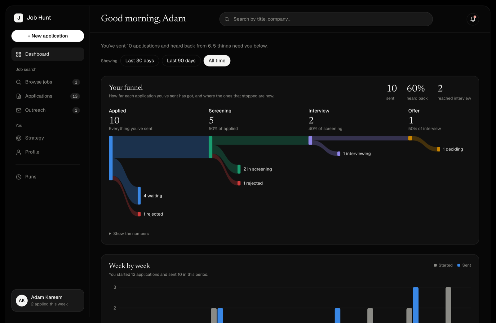
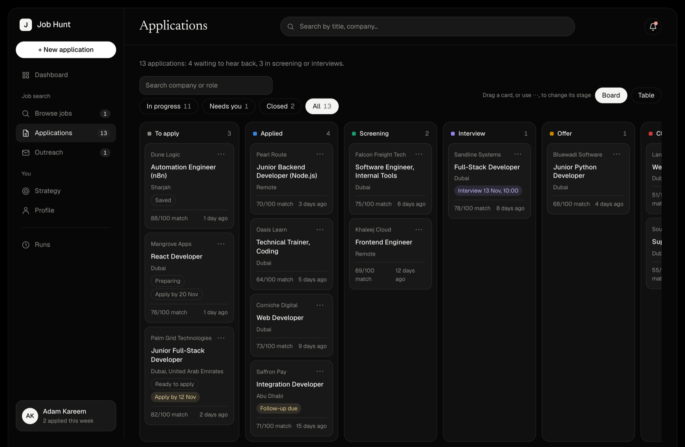
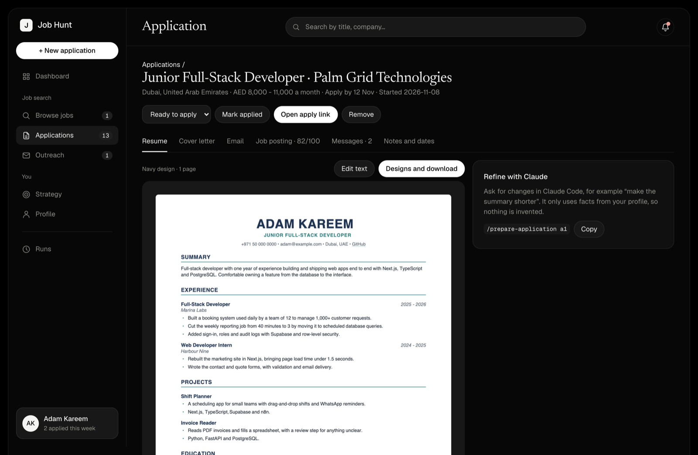
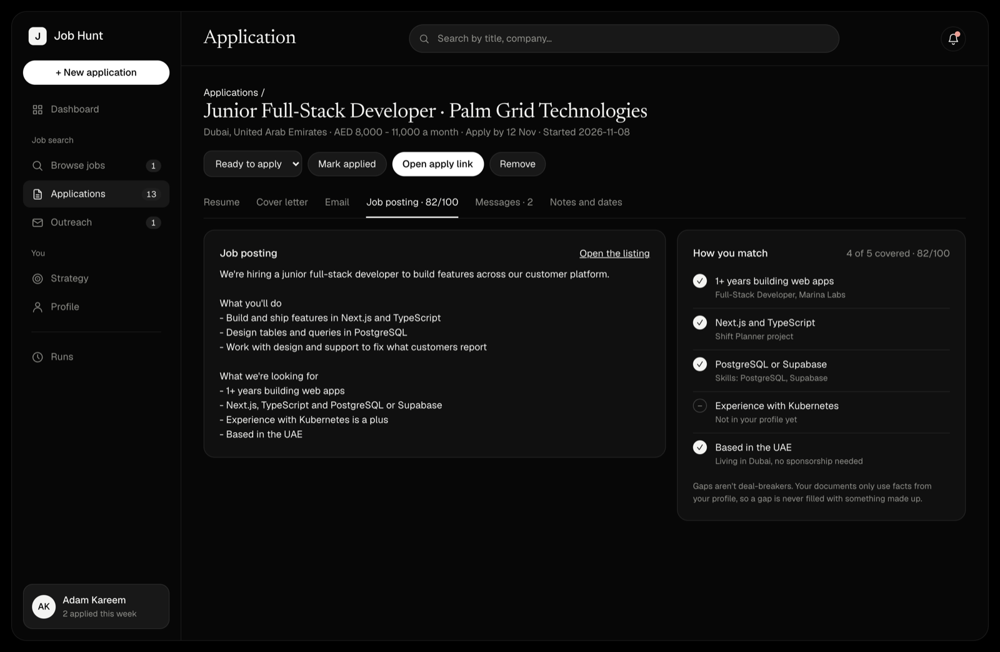

# Gulf Job Hunt

A job search you run from Claude Code, built for the UAE and remote roles.

Claude finds jobs, scores each one against your profile, writes a tailored resume and cover letter, finds who to contact and drafts the message. Everything lands on your own private dashboard on claude.ai, with a board, a funnel and a calendar. You read everything and send it yourself.

There's no server to run and no AI key to buy. It works on your Claude plan.



The screenshots on this page show made-up demo data.

## What it does

- **Finds jobs** on Indeed, LinkedIn and NaukriGulf, and from "we're hiring" posts you paste in.
- **Scores them** from 0 to 100 by your real chance of getting hired, with reasons, and a checklist of each requirement your profile does or doesn't cover.
- **Writes a resume and cover letter** for each job, using only facts from your profile. Twelve PDF designs, plus a Word file.
- **Finds the hiring contact** and drafts a personal message: to a hiring manager, a recruiter, someone you know, or a company that isn't hiring yet.
- **Tracks every application** from saved to offer, with follow-up dates, interview dates and a history of each document.
- **Writes a morning brief**: what to apply to, what to send and what to follow up today.

## A look around

**The board.** Every application in its stage, with apply-by dates, interview times and follow-ups that are due.



**One application.** The tailored resume as the real PDF page, with the cover letter, email, job posting, messages and notes in tabs.



**How you match.** Each requirement in the listing is checked against your profile. A gap is shown as a gap.



To try the dashboard with the demo data, run `npm run demo` and open `demo/index.html` in your browser. Nothing in the demo is saved.

## The rules it follows

- **It never invents experience.** Documents and messages use only what's in your profile. If a job asks for something you don't have, it shows the gap.
- **It never sends or applies.** Claude drafts. You send.
- **It never automates LinkedIn.** No connecting, messaging or applying. No tool that needs your LinkedIn login.
- **Public business contacts only.** No personal emails and no guessed addresses.
- **Your data stays yours.** It lives in your private claude.ai page and in a local folder that git ignores.

The full rules are in [`CLAUDE.md`](CLAUDE.md).

## What you need

- [Claude Code](https://claude.com/claude-code), signed in with a claude.ai account that can publish artifacts. The dashboard is a private artifact page.
- Node.js 22.18 or newer.
- Optional: the Claude in Chrome extension, for `/browse-jobs`.
- Optional: an [Apify](https://apify.com) account, for faster searches. See [Costs](#costs).

## Setup

1. Get the code and install it.
   ```bash
   git clone https://github.com/jasirjaleel/gulf-job-hunt.git
   cd gulf-job-hunt
   npm install
   ```
2. Start Claude Code in the folder.
   ```bash
   claude
   ```
3. Run `/setup`. It publishes your own private dashboard, saves its link on your computer, and builds your profile from your CV and a few questions.
4. Optional, for Apify: copy `.env.example` to `.env.local`, add your Apify API token, approve the `apify` MCP server and sign in with `/mcp`.

## Commands

Run these in Claude Code, in this folder.

| Command | What it does |
| --- | --- |
| `/setup` | First-time setup: your dashboard and your profile |
| `/find-jobs <role> <location>` | Searches Indeed and LinkedIn through Apify, or the web when you have no Apify credit |
| `/browse-jobs [role] [location] [site]` | Reads Indeed, NaukriGulf and LinkedIn job search in your own Chrome, read-only |
| `/add-post <post>` | Turns a hiring post you pasted into a job, a contact and a draft application |
| `/score-jobs` | Scores new jobs against your profile |
| `/prepare-application <job id>` | Writes the tailored resume, cover letter and Word file |
| `/find-hiring-contact <job id>` | Finds the hiring manager or recruiter for a job |
| `/find-companies <sector> <emirate>` | Finds companies worth contacting, with public contacts |
| `/find-recruiters [specialty]` | Finds tech recruiters and agencies |
| `/add-network` | Adds people you know as referral contacts |
| `/draft-outreach <company> [job id] [type]` | Writes a personal message for each contact |
| `/morning-brief` | Writes today's plan to the dashboard |
| `/job-digest` | A short summary of matches and follow-ups |

A usual day: `/morning-brief`, apply to the top matches with `/prepare-application`, then send the drafted messages from the Outreach page.

## Where your data lives

| What | Where | On GitHub? |
| --- | --- | --- |
| Profile, jobs, applications, contacts, messages | Your private dashboard on claude.ai | No |
| A local copy the scripts read | `data/` | No, git ignores it |
| Your dashboard link and your own wording rules | `CLAUDE.local.md` | No, git ignores it |
| Your Apify token | `.env.local` | No, git ignores it |

The dashboard's Profile page has a **Download a backup** button that saves everything as one file.

## Costs

Everything works without Apify. With it, searches are faster and cover more listings.

- Apify's free plan includes a monthly credit, which is USD 5 at the time of writing.
- A search of 25 results costs about 1 cent on LinkedIn and under half a cent on Indeed.
- The backup contact search costs about 8 cents for 20 profiles. It only runs when nothing else finds anyone.
- You set a monthly budget in your profile. When it's nearly used up, `/find-jobs` switches to free web search by itself.
- Claude reports the cost after every paid run.

The scrapers are third-party Apify actors, listed with their prices in [`CLAUDE.md`](CLAUDE.md). Prices can change, so check them on Apify.

## Made for the UAE first

Salaries are monthly and in AED. Scoring knows about UAE experience requirements and roles open to UAE nationals only. Company search works by emirate, and NaukriGulf and Bayt are supported. Remote roles anywhere work too.

For another country you'd need to change the Indeed country in `CLAUDE.md`, the salary reading in `lib/salary.ts` and the UAE checks in `/score-jobs`.

## Using it responsibly

You're responsible for how you use this, including the terms of the job sites and of Apify. The commands are read-only on job sites, keep to small page limits, and stop at any CAPTCHA or sign-in wall. Please keep those limits.

## Credits

- The board, funnel and application pages were inspired by [Dossier](https://github.com/AienTech/dossier), a self-hosted job search app. No code from Dossier is used here.
- PDFs are made with [jsPDF](https://github.com/parallax/jsPDF) and previewed with [PDF.js](https://github.com/mozilla/pdf.js). The dashboard uses the [Newsreader](https://fonts.google.com/specimen/Newsreader) and [Geist](https://fonts.google.com/specimen/Geist) typefaces.

## Licence

[MIT](LICENSE)
